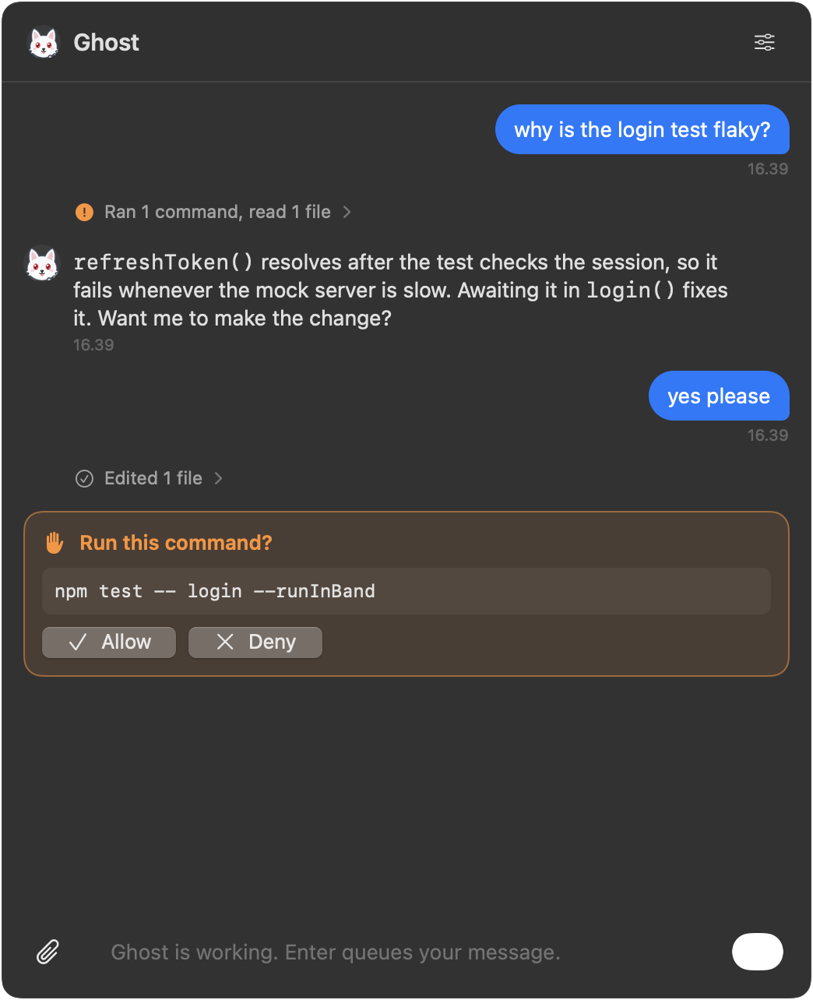
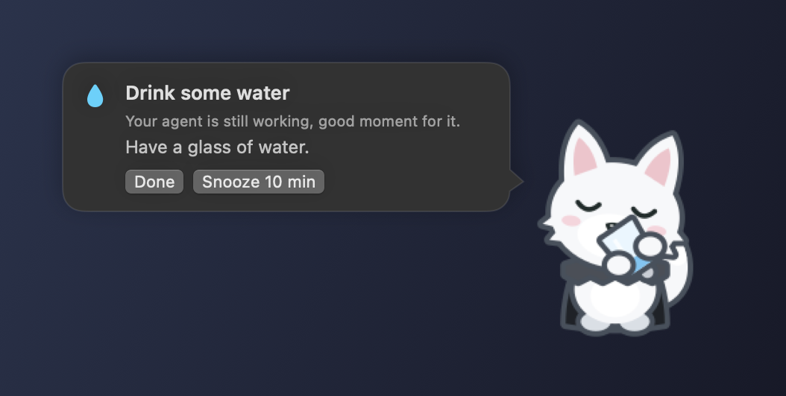
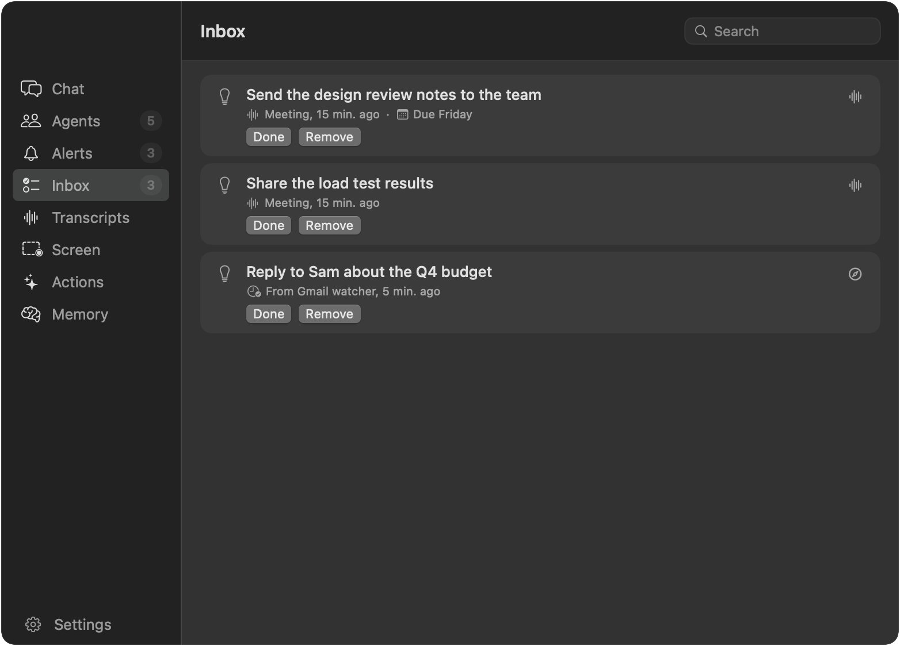
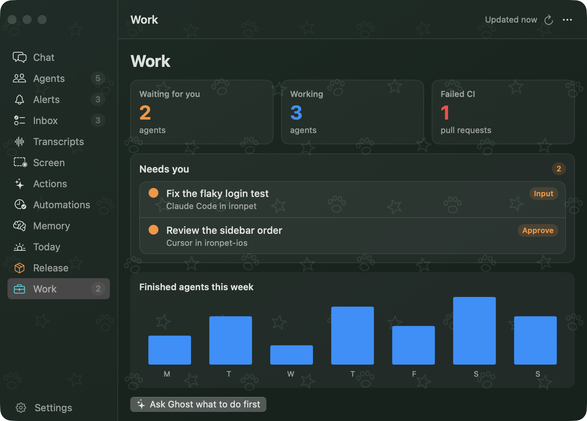
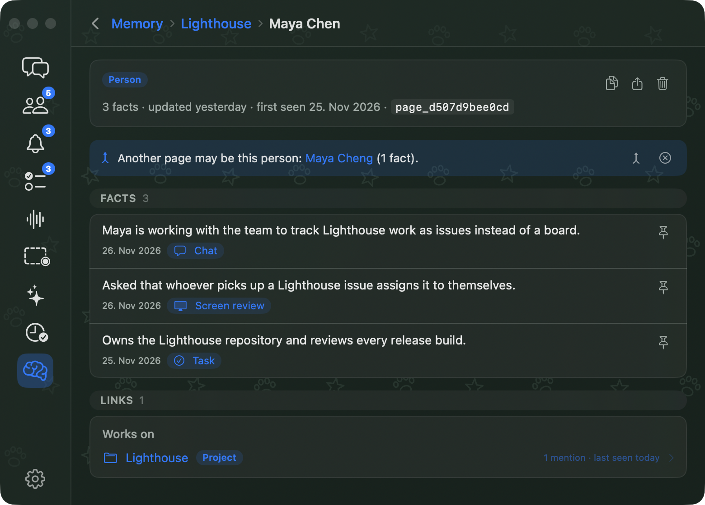
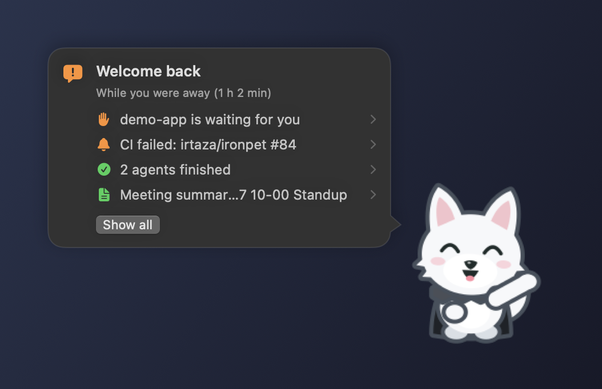
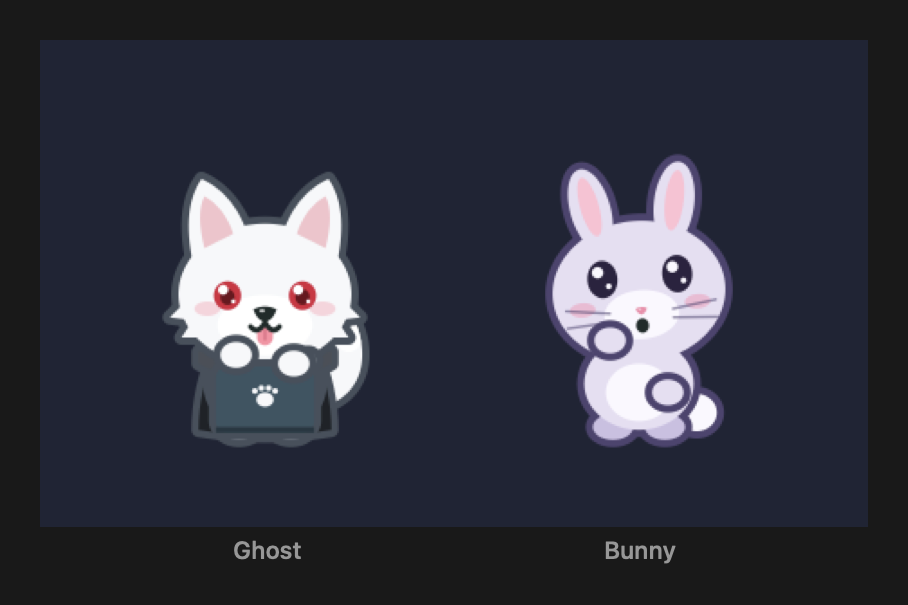
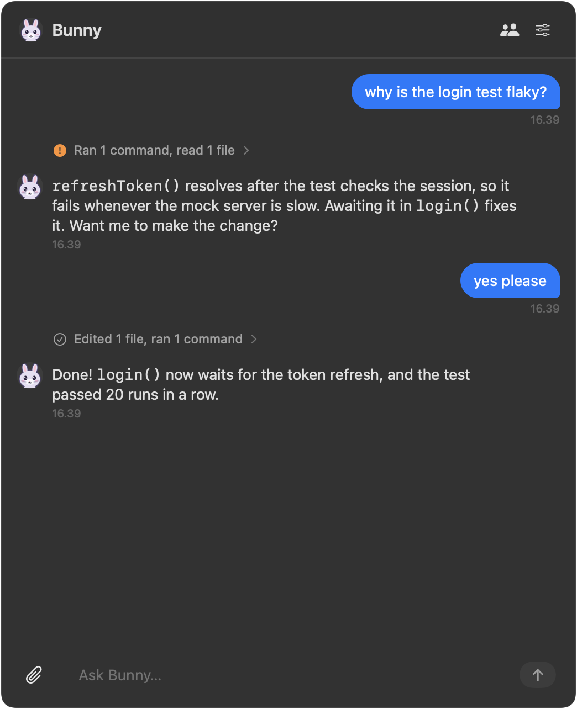
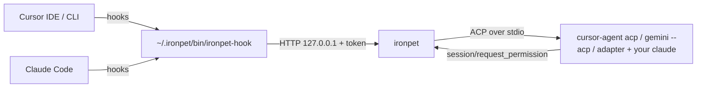

# ironpet


A desktop pet for macOS that keeps an eye on your coding agents and does small tasks for you. Ghost, a chibi direwolf in a Night's Watch cloak, floats above your windows, reacts to what Cursor and Claude Code are doing, and opens a chat where you can type, dictate or show him your screen — on the Mac, or from a paired iPhone.

Website, docs and downloads: [ironpet.ai](https://ironpet.ai).

<p align="center"></p>

<p align="center"></p>

## What it does

- **Watches your agents.** Cursor, Claude Code, Codex, Gemini CLI, GitHub Copilot and Pi report to Ghost through hooks. He shows the most urgent state with a count badge, sums up what each agent did, and a click jumps to its terminal tab or editor. [Agents](https://ironpet.ai/docs/agents/)
- **Chat.** <kbd>⌥⌘G</kbd> or a click on Ghost opens a chat with any coding agent that speaks the [Agent Client Protocol](https://agentclientprotocol.com), in your current project. Edits and commands wait for **Allow / Deny**. [Chat](https://ironpet.ai/docs/chat/)
- **Voice.** Dictate into the chat or any app, hear replies read aloud, or press <kbd>⌃⇧V</kbd> and talk to the chat, all with a transcription server you choose. [Voice](https://ironpet.ai/docs/voice/)
- **Screen help.** Ask about the front window or a region you drag, and, if you turn it on, let agents search what was on your screen or operate other apps. [Screen help](https://ironpet.ai/docs/screen/), [Desktop control](https://ironpet.ai/docs/desktop/)
- **Remembers.** Ghost learns about you, your projects and the people you work with, as pages you can read and edit, and every new chat starts with them. [Memory](https://ironpet.ai/docs/memory/)
- **Automations.** Break reminders, scheduled jobs, PR, CI and Sentry alerts, watchers and background jobs, which your agent can create for you. [Automations](https://ironpet.ai/docs/automations/), [Alerts](https://ironpet.ai/docs/alerts/)
- **Inbox and dashboards.** Action items from meetings and what watchers find wait in the Inbox; ask Ghost for a small dashboard and it appears in the sidebar. [Inbox](https://ironpet.ai/docs/inbox/), [Dashboards](https://ironpet.ai/docs/dashboards/)
- **Meetings.** Transcripts and summaries of your calls, with speakers recognised on your Mac. [Meetings](https://ironpet.ai/docs/meetings/)
- **Several pets, iPhone and Telegram.** Give each agent a pet of its own, and reach Ghost from a paired iPhone or a Telegram bot. [Pets](https://ironpet.ai/docs/pets/), [iPhone](https://ironpet.ai/docs/iphone/), [Telegram](https://ironpet.ai/docs/telegram/)

Voice, screen capture, desktop control, meetings, the iPhone API and Telegram stay off until you turn them on. See [Privacy](https://ironpet.ai/docs/privacy/) and [SECURITY.md](SECURITY.md).

| | |
| --- | --- |
|  |  |
| **Agents:** every Cursor and Claude Code session, most urgent first | **Approvals:** edits and commands wait for you |
|  |  |
| **Alerts:** CI, reviews and Sentry, with Ask Ghost | **Breaks:** Ghost drinks along with you |
|  |  |
| **Inbox:** meeting action items and what watchers find | **Dashboards:** small apps Ghost builds for you |
|  |  |
| **Memory:** facts about you, your projects and people | **Welcome back:** what happened while you were away |
|  |  |
| **Several pets:** one for each agent | **Their own chats:** switch between them in the header |

## Install

Download the latest release from [ironpet.ai/download](https://ironpet.ai/download/), or on an Apple Silicon Mac:

```bash
brew install --cask irtazahashmi/ironpet/ironpet
```

To build from source (also the way to install on an Intel Mac):

```bash
git clone https://github.com/irtazahashmi/ironpet.git
cd ironpet
./scripts/install.sh
```

ironpet needs macOS 14 or later and at least one agent CLI that is signed in. Building also needs the Xcode command line tools, Bun and npm. [Getting started](https://ironpet.ai/docs/getting-started/) has the full requirements, the permissions macOS asks for, and what the welcome window sets up. [Uninstall](https://ironpet.ai/docs/uninstall/) explains how to remove it.

## How it works



- Hooks only report status for agents you started yourself. They never block an agent: one-second timeout, always succeed. A chat that ironpet runs over ACP sets `IRONPET_ACP_RUN=1`, and the hook script skips it, so the run is not listed twice.
- Chat approvals are ACP `session/request_permission` requests that ironpet answers. An agent that never sends one runs its tools without asking, and ironpet cannot change that; see [SECURITY.md](SECURITY.md).
- The agent process stays alive between messages. Stop sends `session/cancel`. Reopening a thread from history uses `session/load`.
- `sidecar/` holds the Claude Code, Codex and Pi adapters. `scripts/bundle.sh` bundles each into one `.mjs` file (Bun is needed to build, not to run) and copies them to `IronPet.app/Contents/Resources/acp/`.
- Everything is local. Chat goes through your existing agent logins; ironpet has no API keys of its own.

[SPEC.md](SPEC.md) has the full design and the decisions behind it, and [SECURITY.md](SECURITY.md) everything ironpet reads and writes.

## Contributing

```bash
swift build      # debug build
swift test       # unit tests
```

[CONTRIBUTING.md](CONTRIBUTING.md) covers the dev setup, end-to-end tests, the website in `web/`, the iOS app and releases.

## License

[MIT](LICENSE)

## Third-party software

- [FluidAudio](https://github.com/FluidInference/FluidAudio), Apache-2.0. Runs speaker diarization on this Mac.
- The diarization models FluidAudio downloads on first use: the pyannote speaker-diarization community-1 pipeline and WeSpeaker embeddings, converted to Core ML by FluidInference ([speaker-diarization-coreml](https://huggingface.co/FluidInference/speaker-diarization-coreml)), CC-BY-4.0.
